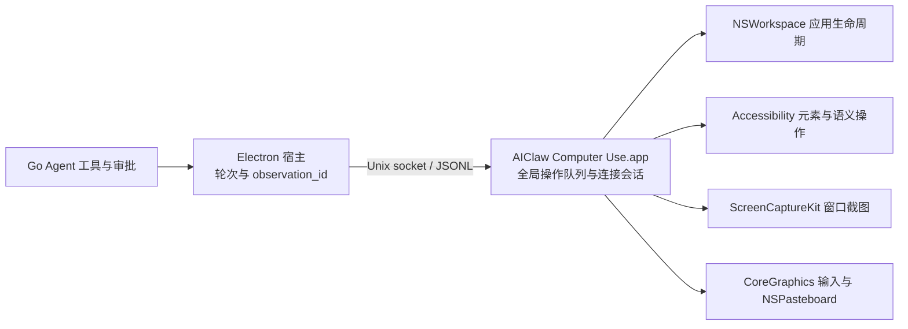

# AIClaw 原生桌面控制

AIClaw 当前产品工具在 **macOS 14.4 及以上**通过自有 Swift 应用 **AIClaw Computer Use.app** 执行桌面控制。Electron 宿主负责模型循环、审批与操作后的验证；独立原生进程负责应用发现、AX 元素、窗口截图和输入。Windows/Linux 执行层仍在开发、尚未注册产品工具或接入发布包。

实现源码在 `tools/computer-use/Sources/`。本轮依据 Codex 已发布产物恢复出的接口形状重建桌面能力，调查证据和未实现能力见 [Codex 能力与证据盘点](codex-computer-use-evidence.md)。没有复制或加载 Codex 的私有运行时。

## 进程、身份与 IPC

安装包携带 helper，每次启动 AIClaw 时在后台校验签名并同步到固定用户目录 `~/.aiclaw/computer-use/AIClaw Computer Use.app`，无需先调用桌面控制工具；开发与正式安装均从这个位置运行。相同产物不重复复制；更新使用安装锁、同目录暂存与原子替换，校验失败保留旧 App 并记录应用日志，首次使用时仍会重试安装。同步本身不启动 helper 或请求系统权限。宿主通过 LaunchServices 启动该 helper，再直接连接其 Unix socket；不经过 CLI 代理或用户 MCP 配置。原生框架不加载到 Electron 内。

协议是 **`AIClawComputerUseIPC-1`**。请求使用 `{id, requestType, request}`，响应为 `{id, result}` 或 `{id, error}`。请求名称参考恢复出的 Codex 接口，**不与 `CodexComputerUseIPC-5` wire 兼容**。握手返回版本、工具清单和进程启动时捕获的自身可执行文件 SHA-256；宿主拒绝版本或可执行身份不匹配的驻留进程。

socket 名称包含规范化 bundle 路径和可执行文件 hash，因此不同可执行构建代际不会共享同一端点；开发与正式安装共享固定用户安装位置。socket 权限为 `0600`，父目录必须属于当前用户且不可由其他用户写入；服务验证连接 peer UID。JSONL 单帧上限为 16 MiB。此服务信任同 UID 的本机客户端；原生层不执行聊天审批，Go 审批只约束 AIClaw 工具入口。此边界不隔离当前用户的其他进程，也未还原 Codex 的发送者鉴权机制。

每个聊天轮次持有独立连接和 `ComputerSession`。宿主按序派发，原生服务另有覆盖完整异步请求生命周期的全局队列，避免不同连接在等待截图或输入时交错。断连立即标记连接失效，取消活动任务并丢弃尚未派发的请求；按键、鼠标按住操作有取消释放路径。轮次结束、归档、删除或关闭连接会清掉观测，不重放输入。驻留 helper 可继续运行，不安装 launch daemon。

## 权限与输入方式

辅助功能和屏幕录制权限属于 **AIClaw Computer Use.app**，与 Electron、AIClaw 主应用及其他 helper 分开。`computer_permissions` 只读当前状态；缺少所需权限的观察或动作返回错误，并显示独立权限说明窗口。窗口按钮在用户点击后向系统请求登记并打开对应设置，由 macOS 决定授权，不自动授予权限。

AX 查询和语义操作要求辅助功能权限；截图还要求屏幕录制权限。应用发现和生命周期操作不额外要求 AX。宿主审批仍遵循当前聊天策略，禁止把 AIClaw、其 helper 或审批窗口作为操作目标。

语义点击、设值、选择文本与辅助操作使用公开 AX API。坐标点击、拖动、滚动、按键、输入和粘贴使用项目自己的前台投递：先激活并重新验证目标应用/窗口，再发送 CoreGraphics 事件，可能切换前台、焦点或移动鼠标。**不承诺后台无干扰输入**，也未复刻 Codex 私有 SkyLight 投递路径。并发人工操作仍可能改变目标状态，操作回执不等于业务完成。

### 严格后台模式

九类输入工具新增 `interaction_mode=foreground|background`，默认仍为 foreground。background 当前仅支持单次无修饰键的 AXPress 元素点击、无自动提交的设值、文本选择和元素辅助动作；AXPress 不支持时直接失败，不回退到坐标或激活目标。键盘、粘贴、滚动、拖动、坐标点击及带修饰键/长按/多击的后台请求在派发前拒绝。

后台路径不调用激活、全局输入或剪贴板写入，并在回读时检查前台 PID、指针位置和剪贴板代际。若目标应用自行切换前台或用户并发操作造成变化，返回结果未知，不自动恢复焦点或重放动作。这是对已实现语义操作的严格模式，不是任意应用、任意动作的后台输入实现。

原生纯逻辑测试覆盖支持矩阵与禁止回退条件；宿主 IPC 测试覆盖模式传递。授权后，`electron scripts/smoke-computer-background.cjs` 已用两个临时 AppKit 应用实测设值、选择文本、步进器辅助动作和点击生效，并核对前台保持、鼠标不动、剪贴板全部可读格式内容不变；不支持的后台输入被拒绝。回执见 [后台与持续观察验收](/Users/zhouyy/.codex/visualizations/2026/11/05/01a1aacb-6689-7b11-841f-9bcc35cb2d46/computer-use-roadmap/background-live-summary.json)。不据此宣称任意应用和任意动作都支持后台执行。

## 原生动作与宿主工具

契约统一保存在 `tools/claw-agent/internal/agent/computer-tools.json`，构建时作为 `Tools.json` 放入 helper；握手投影原生参数，宿主独立校验字段。

18 个原生工具之外，宿主的 `computer-host-tools.json` 定义 3 个持续观察工具及 `computer_app_policy`，合计 22 个 Agent 工具；宿主工具不冒充原生 helper 的 IPC 方法。

| 能力 | 工具 | 行为 |
| --- | --- | --- |
| 权限与发现 | `computer_permissions`、`computer_list_apps`、`computer_find_apps`、`computer_frontmost_window` | 返回权限、应用候选和窗口 ID；发现合并有时限的 Spotlight 索引与 NSWorkspace 运行态，保留截断/索引未完成标记 |
| 应用生命周期 | `computer_start_app`、`computer_stop_app`、`computer_modify_app` | 精确 bundle ID 启动、正常退出、激活或隐藏；`deactivate` 明确实现为 hide，不强杀进程 |
| 观察与查询 | `computer_screenshot`、`computer_query` | 窗口截图/可选 AX 树，或按文字和角色查询控件；支持显式窗口 ID 消歧 |
| 九类动作 | `computer_click`、`computer_drag`、`computer_key`、`computer_type`、`computer_scroll`、`computer_set_value`、`computer_secondary_action`、`computer_select_text`、`computer_paste` | 覆盖恢复出的九种桌面 Action；点击修饰键、按住时长、按键时长、坐标滚动均有明确参数 |

`computer_screenshot` 默认只取截图，`include_ax=true` 才遍历完整 AX 树。ScreenCaptureKit 仅捕获选定窗口，PNG 长边限制为 1280 像素；坐标使用返回图像像素，服务据记录的图像尺寸和窗口几何换算。几何变化要求重新观察。

`computer_query` 是 AIClaw 的扩展，不是已经证明与 Codex 相同的搜索算法。它按文字/AX 角色进行有预算的定向遍历，返回匹配索引、窗口信息、访问数量与截断原因。空结果且搜索被截断时不能据此判定控件不存在。

`computer_select_text` 以原生字符串的 UTF-16 范围处理 Unicode，支持 prefix/suffix 消歧与选中/前后光标，并读回选择范围。`computer_paste` 支持 text、Markdown、HTML，由原生 NSPasteboard 准备并用前台 Command-V 投递；先物化保存原剪贴板，恢复时保留期间发生的新复制。异步粘贴与剪贴板消费效果仍需实际观察，不能把派发成功当成目标应用已消费。

## 观测与失败规则

宿主为观察分配 `observation_id`，动作必须携带本聊天、本轮次、本应用的最新 ID。查询只授权该次返回索引上的语义动作，不能用于任意键盘或坐标输入。像素动作要求截图，元素动作要求 AX 观测。应用生命周期操作会使相关观测失效。

原生索引只在所属连接中有效。动作前重新核对进程、窗口、角色、标题/描述/标识符、父窗口关系和当前几何；每个连接只保留当前目标窗口；切换应用、新观察、动作或断连清掉旧句柄。应用发现中的窗口 ID 只是选择依据，不授权未经观察的输入。

动作后默认由宿主请求新的截图验证，并清掉旧索引。截图相同会提示没有可见进展；截图失败仍保留已派发回执，标记结果未知，并以失败返回工具入口以中断脚本。原生错误、空结果、缺图、超时或断连不会伪造成成功；超时关闭连接，后续必须重新观察。启动进程不是完成用户任务，正常退出未确认时保留保存对话框等可能性，不强制终止。

### 连续执行编排

启用代码模式时，`computer_*` 与其他工具一起收进 `exec`；确定的步骤可用顺序 `await tools.computer_query(...)`、设值、新查询、点击组合执行，中间无需返回模型。每个动作仍通过原工具 handler 和本轮审批环境；禁止使用并发桌面操作。

写操作可设 `verify_after=false`，只省略自动截图，不保留旧 observation_id 或元素索引。下一次输入前仍须重新查询/观察，在视觉判断点或任务完成时显式截图。查询首行是 JSON，后续行带 observation_id；脚本需核对匹配数量和截断标记，遇不明确目标返回模型。原生错误、审批拒绝或自动验证失败均会拒绝工具 Promise，顺序脚本停止；不得自动重放输入。未启用代码模式时保留独立工具调用与默认逐步截图。

阶段验证：Agent/代码模式/协议包 race 测试及宿主测试通过；一段 exec 的查询→设值→查询→点击→截图仅经历一次工具轮次，审批拒绝、宿主失败及未知验证结果会截断后续调用；执行中取消会阻止下一次输入派发。原生 18 工具 IPC 握手已验证。当前构建的九类原生动作已用临时应用完成真实输入回归，包含中文/emoji、Markdown/HTML 粘贴、剪贴板恢复和正常退出。

### 持续观察与增量更新

`computer_watch_start` 订阅一个明确应用窗口，返回首帧截图与无动作索引的 AX 基线；`computer_watch_next` 等待序号之后的变化；`computer_watch_stop` 停止。实现为宿主独立连接上的周期采样，间隔 500–5000ms（默认 1000ms），不是逐帧 ScreenCaptureKit 流或 AX 事件订阅。采样不会改动普通工具连接的元素表和 observation_id。

每个聊天轮次最多一个订阅，进程内最多四个，只保留最新两份样本，不落盘、不建立历史。AX 文本剥离每次采样重新生成的索引；内容变化返回可重建的行 splice，消费者落后时返回完整基线及跳过数量；PNG 仅在图像变化或重置时返回。采样元数据保留截断标记，不能将截断树视为完整界面。

订阅快照没有动作授权，下一次输入仍须显式查询/观察。目标进程或窗口变化、采集失败会停止采样并报告错误；停止、轮次/会话关闭或消费者闲置 60 秒会关闭连接和等待者。等待更新不占用桌面动作队列。

单元测试覆盖静止帧去重、AX 增量重建、图像增量、消费者落后重置、跨聊天隔离、取消、闲置清理和进程替换。临时 AppKit 双窗口验收已证实静止窗口不产生索引变化事件、后台改值生成正确 AX/图像增量、动作观测在采样后仍有效，以及停止能取消等待。

### 应用专用策略

`computer_app_policy` 返回项目维护的 Finder、Safari、TextEdit 策略；按精确 bundle ID 匹配，其他应用回退通用发现策略。首次查询或截图还会附带对应应用的 `app_specific_instructions`，同一应用每轮只附带一次。策略是操作指引，不是权限授予、固定控件坐标或自动执行脚本；选择器仍须由当前观察确认。

Finder 的路径导航、Safari 地址栏与页面的区分、TextEdit 文档/格式/保存的区分依据 Apple 文档组织；来源随策略一起返回。策略不会启动应用或创建动作观测，也不宣称每个 UI 版本的全部工作流已验收。

### 后续阶段顺序

1. 连续执行编排：实现、race/审批/取消测试及原生输入回归通过。
2. 后台无干扰操作：严格 AX 语义模式真实双应用验收通过；全种类后台键鼠输入仍未实现，明确拒绝且不回退前台。
3. 持续观察与增量更新：轮询订阅、增量、生命周期及真实窗口变化验收通过；逐帧/原生事件流尚未实现。
4. 应用专用操作策略：Finder/Safari/TextEdit 策略、通用回退及按轮次注入已实现；并非所有应用的自动化工作流库。
5. Windows/Linux 桌面控制：执行层开发与平台验证准备中，尚未启用工具。

### Windows/Linux 开发状态

Linux 原型源码位于 `tools/computer-use/linux/`，直接调用 X11/XTest/XComposite 和 AT-SPI，使用系统 Python/PyGObject，不下载第三方桌面控制服务。每个连接由宿主启动一个私有 stdio 子进程，协议握手核对服务与绑定源码的 SHA-256；EOF 取消排队操作，停止后关闭连接。目标限定当前用户的明确 PID 和窗口，复核进程启动标识、AT-SPI 元素身份和几何。

隔离 D-Bus/Xvfb + GTK 双应用原生测试已经验证发现、后台设值/选择/点击、按键回读、Unicode 插入、拖动、滚动及窗口 PNG。截图通过 XComposite 为目标客户端窗口申请独立 backing storage，不裁剪根屏幕；前台蓝色测试窗口遮挡目标时，捕获的红色目标像素已验证。该路径参考 X11 API 及 [WebRTC 原生窗口捕获实现的接口使用方式](https://webrtc.googlesource.com/src/+/3f4d30b1938020da1e24e0df155af4da4d0a2b1a/modules/desktop_capture/linux/x11/window_capturer_x11.cc)，不是加载其驱动。

编译后的宿主控制器到真实 Linux 子进程的联调已验证源码身份握手、后台提交回执、PNG、静止帧去重、AX 增量重建，以及轮次结束取消等待。启动只接受当前连接发现的 `.desktop` 入口，重新核对文件 hash，并用实际启动回调的 PID 和进程出生标识确认新窗口；不能确认时返回未知，不重放启动。

Linux 前台纯文本粘贴已在 GTK 控件回读中文与 emoji。剪贴板事务保存所有可读取的原始格式（最多 64 格式、合计 16 MiB，超限在输入前拒绝），通过 XFixes 代际和同一 GDK X 连接的 server grab 避免覆盖期间发生的新复制。真实测试验证 HTML 和自定义二进制格式恢复、过期代际拒绝覆盖。X11 剪贴板数据依赖所有者存活，因此连接 EOF 后关闭输入/截图连接并清除元素，只在需要时继续提供已恢复的剪贴板字节；独立控制管道告知宿主不要终止该提供者。下一次复制后自动退出，不写历史或磁盘。宿主真实测试已验证跨越正常子进程退出期限仍可读取全部原格式，并在新复制后退出。

Linux 服务当前仅接受 text/HTML 粘贴格式；HTML 的真实富文本消费、Markdown 转换、完整参数对齐、安装/打包和 Agent 工具启用尚未验收。Wayland 需要 portal 会话，当前 X11 原型明确拒绝 Wayland。Windows 的自有 Win32/UIA 执行层和双 WinForms 测试已加入独立 CI，已解决标准控件代理初始化问题，后台动作不干扰检查仍在验收。不能将这些原型测试作为第五阶段完成证明。

## 构建、打包与签名

`node scripts/build-computer-runtime.mjs --universal` 在 macOS 上编译 arm64/x86_64，合并 universal 可执行文件，生成 bundle、工具资源和 hash 元数据，并校验签名。`make build-computer` 可构建本机版本。运行时随应用放在 ASAR 外，首次使用不下载驱动。

CI 的 macOS job 构建并验证 universal helper，上传 tar artifact；Linux 打包 job 接收该产物，为两个 macOS 架构交叉打包。Windows/Linux 包不附带原生桌面替代实现。

当前验证使用 **ad-hoc 开发签名**。构建脚本支持 `COMPUTER_USE_SIGN_IDENTITY`，但尚未配置生产证书或完成公证。不能据此保证更新后的权限持续有效；生产交付需要稳定签名身份与单独的安装、升级验收。

## 验证状态

2026-11-05 已完成：

- arm64/x86_64 universal 原生构建、签名完整性检查、真实 IPC 握手与 18 工具契约检查。
- 固定用户目录安装：相同构建不重复写入，更新候选验证失败保留旧 App，并发安装和链接目标拒绝测试通过。
- 352 项渲染/宿主测试、相关 Go 包测试、TypeScript 类型检查、Go 格式/vet/no-cgo 检查通过。
- 实际辅助功能与屏幕录制状态均为 true；应用发现、正常退出、重新启动与激活均以临时 AppKit fixture 验收。
- 九类原生动作实际生效：点击、拖动、按键、Unicode 输入、坐标滚动、设值、UTF-16 文本选择、辅助动作和粘贴。
- text、Markdown、HTML 粘贴在目标编辑器中验证；Markdown/HTML 加粗和中文编码正确，原剪贴板文本恢复。Markdown 标题、列表、表格、链接与转义另有原生转换测试。

[实际提交回执](/Users/zhouyy/.codex/visualizations/2026/11/05/01a1aacb-6689-7b11-841f-9bcc35cb2d46/rea-search/native-live-summary.json) 记录了 Unicode 值、富文本加粗、拖动/滚动事件及一次步进器辅助动作；[验证截图](/Users/zhouyy/.codex/visualizations/2026/11/05/01a1aacb-6689-7b11-841f-9bcc35cb2d46/rea-search/native-fixture-verified.png) 来自本实现选定窗口的 ScreenCaptureKit 截图。测试不操作已有用户应用或发送外部数据。

事件投递后的短暂窗口变化只重试只读观察，最多两次；输入本身不重放。开发构建采用时间戳依赖，未修改原生源、工具契约或版本时 `make dev` 不重复编译/签名。

上述结果验证本机 macOS arm64 上的测试 App，不证明任意第三方 App 或实际 x64 输入效果。仍使用开发签名，未完成生产证书、公证及升级授权保持验收。本轮新增的是轮询观察/AX 文本增量和项目维护的应用策略；原生逐帧/AX 事件流、历史、音频、日历、短信和锁屏能力仍见证据报告的差距清单。
