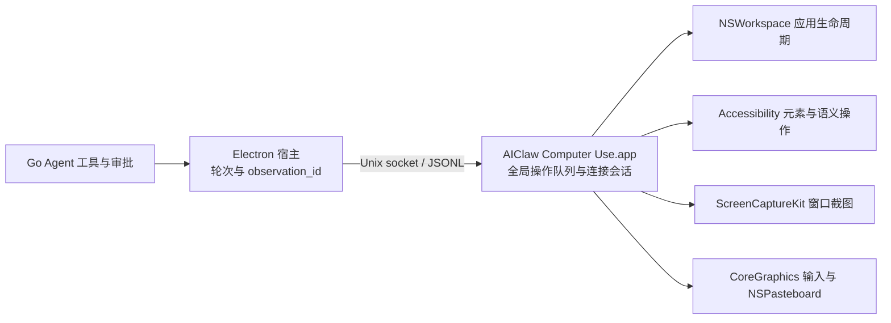

# AIClaw 原生桌面控制（历史方案）

> 此独立 App 方案已由 [内嵌 Cua Driver](cua-driver.md) 替代。以下内容保留为历史实现记录，不是当前运行入口。

AIClaw 当前产品工具在 **macOS 14.4 及以上**通过自有 Swift 应用 **AIClaw Computer Use.app** 执行桌面控制。Electron 宿主负责模型循环、审批与操作后的验证；独立原生进程负责应用发现、AX 元素、窗口截图和输入。Windows/Linux 自有执行层、用户目录安装同步及 22 个产品工具注册已接入开发分支。Linux 当前支持 X11，Wayland 明确拒绝；完整安装包启动验收见下方验证状态。

实现源码在 `tools/computer-use/Sources/`。本轮依据 Codex 已发布产物恢复出的接口形状重建桌面能力，调查证据和未实现能力见 [Codex 能力与证据盘点](codex-computer-use-evidence.md)。没有复制或加载 Codex 的私有运行时。

## 进程、身份与 IPC

安装包携带 helper，每次启动 AIClaw 时在后台校验签名并同步到固定用户目录 `~/.aiclaw/computer-use/AIClaw Computer Use.app`，无需先调用桌面控制工具；开发 Electron 使用独立的 `~/.aiclaw/computer-use-development/AIClaw Computer Use.app`，避免覆盖正式安装。相同产物不重复复制；更新使用安装锁、同目录暂存与原子替换，校验失败保留旧 App 并记录应用日志，首次使用时仍会重试安装。同步完成后，macOS 启动流程通过 LaunchServices 启动 helper，并经身份校验的 IPC 检查辅助功能与屏幕录制权限；缺少任一项时显示授权引导窗口，全部具备时不弹窗。只有用户点击引导按钮才调用对应系统授权 API、打开系统设置；实际授权由用户确认。启动检查不执行截图或桌面输入，完成后关闭检查连接。宿主通过 LaunchServices 启动该 helper，再直接连接其 Unix socket；不经过 CLI 代理或用户 MCP 配置。原生框架不加载到 Electron 内。

协议是 **`AIClawComputerUseIPC-1`**。请求使用 `{id, requestType, request}`，响应为 `{id, result}` 或 `{id, error}`。请求名称参考恢复出的 Codex 接口，**不与 `CodexComputerUseIPC-5` wire 兼容**。宿主先将已连接 socket 的文件描述符传给已验签 helper 的只读验证入口，以内核 peer audit token 验证服务端真实身份、路径及当前工件的签名 slice；任何应用帧发送前完成验证。真实 Rosetta x64 验证器连接 arm64 服务已通过。随后握手返回版本、工具清单和进程启动时捕获的自身可执行文件 SHA-256；宿主拒绝版本或可执行身份不匹配的驻留进程。该机制以宿主和 helper 工件未被篡改为前提，不宣称抵御同 UID 对验证器可执行文件本身的并发替换。

socket 名称包含规范化 bundle 路径和可执行文件 hash，因此不同可执行构建代际不会共享同一端点；开发与正式安装使用独立的用户安装目录。socket 权限为 `0600`，父目录必须属于当前用户且不可由其他用户写入；本分支在同 UID 校验之外，通过内核 peer audit token 验证真实调用进程的代码签名；production 仅接受固定证书签名且标识为 `com.github.chowyu12.aiclaw` 的宿主。JSONL 单帧上限为 16 MiB。开发 helper 使用编译期固定的本机 Electron CDHash，输出到独立 development 目录；打包拒绝开发产物。没有运行参数或客户端自报字段能够切换生产信任。原生层不执行聊天审批，Go 审批仍位于 AIClaw 工具入口；本设计不宣称复刻 Codex 私有鉴权机制。

正式安装替换 helper 前，迁移专用服务只接受可信宿主的握手和旧服务退休请求。它按真实进程路径、签名、代际及 socket 活跃连接检查旧驻留服务；忙碌或无法验证时拒绝替换，保留旧进程并提供诊断。不自动强杀，也不修改 TCC。开发安装不清退正式服务。

每个聊天轮次持有独立连接和 `ComputerSession`。宿主按序派发，原生服务另有覆盖完整异步请求生命周期的全局队列，避免不同连接在等待截图或输入时交错。断连立即标记连接失效，取消活动任务并丢弃尚未派发的请求；按键、鼠标按住操作有取消释放路径。轮次结束、归档、删除或关闭连接会清掉观测，不重放输入。驻留 helper 可继续运行，不安装 launch daemon。

## 权限与输入方式

辅助功能和屏幕录制权限属于 **AIClaw Computer Use.app**，与 Electron、AIClaw 主应用及其他 helper 分开。`computer_permissions` 只读当前状态；缺少所需权限的观察或动作返回错误，并显示独立权限说明窗口。窗口按钮在用户点击后向系统请求登记并打开对应设置，由 macOS 决定授权，不自动授予权限。

AX 查询和语义操作要求辅助功能权限；截图还要求屏幕录制权限。应用发现和生命周期操作不额外要求 AX。宿主审批仍遵循当前聊天策略，禁止把 AIClaw、其 helper 或审批窗口作为操作目标。

语义点击、设值、选择文本与辅助操作使用公开 AX API。坐标点击、拖动、滚动、按键、输入和粘贴使用项目自己的前台投递：先激活并重新验证目标应用/窗口，再发送 CoreGraphics 事件，可能切换前台、焦点或移动鼠标。**不承诺后台无干扰输入**，也未复刻 Codex 私有 SkyLight 投递路径。并发人工操作仍可能改变目标状态，操作回执不等于业务完成。

### 严格后台模式

九类输入工具新增 `interaction_mode=foreground|background`，默认仍为 foreground。background 当前仅支持单次无修饰键的 AXPress 元素点击、无自动提交的设值、文本选择和元素辅助动作；AXPress 不支持时直接失败，不回退到坐标或激活目标。macOS 另外支持受限后台 `type_text`/`press_key`，要求新截图建立的可编辑焦点、进程代际、窗口、字段值及选择范围证明。AppKit 使用公开 PID 定向事件；已验证 Web 文本字段使用明确标注的 AX 字面插入适配，富文本非空区域拒绝该适配。仅允许普通键及 Shift，Cmd/Ctrl/Alt 拒绝；详见[后台键盘边界与验收](computer-use-background-keyboard.md)。粘贴、滚动、拖动、坐标点击及带修饰键/长按/多击的后台点击请求仍在派发前拒绝。

后台路径不调用激活、全局输入或剪贴板写入，并在回读时检查前台 PID、指针位置和剪贴板代际。若目标应用自行切换前台或用户并发操作造成变化，返回结果未知，不自动恢复焦点或重放动作。这是对已实现语义操作的严格模式，不是任意应用、任意动作的后台输入实现。

原生纯逻辑测试覆盖支持矩阵与禁止回退条件；宿主 IPC 测试覆盖模式传递。授权后，`electron scripts/smoke-computer-background.cjs` 已用两个临时 AppKit 应用实测设值、选择文本、步进器辅助动作和点击生效，并核对前台保持、鼠标不动、剪贴板全部可读格式内容不变；不支持的后台输入被拒绝。回执见 [后台与持续观察验收](/Users/zhouyy/.codex/visualizations/2026/11/05/01a1aacb-6689-7b11-841f-9bcc35cb2d46/computer-use-roadmap/background-live-summary.json)。不据此宣称任意应用和任意动作都支持后台执行。

## 原生动作与宿主工具

契约统一保存在 `tools/claw-agent/internal/agent/computer-tools.json`，构建时作为 `Tools.json` 放入 helper；握手投影原生参数，宿主独立校验字段。

18 个原生工具之外，宿主的 `computer-host-tools.json` 定义 3 个持续观察工具及 `computer_app_policy`，合计 22 个 Agent 工具；宿主工具不冒充原生 helper 的 IPC 方法。

| 能力 | 工具 | 行为 |
| --- | --- | --- |
| 权限与发现 | `computer_permissions`、`computer_list_apps`、`computer_find_apps`、`computer_frontmost_window` | 返回权限、应用候选和窗口 ID；发现合并有时限的 Spotlight 索引与 NSWorkspace 运行态，保留截断/索引未完成标记 |
| 应用生命周期 | `computer_start_app`、`computer_stop_app`、`computer_modify_app` | 精确 bundle ID 启动、正常退出、激活或隐藏；`deactivate` 明确实现为 hide，不强杀进程 |
| 观察与查询 | `computer_screenshot`、`computer_query` | 窗口截图/可选 AX 树，或按文字和角色查询控件；支持显式窗口 ID 消歧 |
| 九类动作 | `computer_click`、`computer_drag`、`computer_key`、`computer_type`、`computer_scroll`、`computer_set_value`、`computer_secondary_action`、`computer_select_text`、`computer_paste` | 覆盖恢复出的九种桌面 Action；点击修饰键、按住时长、按键时长、坐标滚动均有明确参数 |

`computer_screenshot` 默认只取截图，`include_ax=true` 才遍历完整 AX 树。ScreenCaptureKit 仅捕获选定窗口，PNG 长边限制为 1280 像素；坐标使用返回图像像素，服务据记录的图像尺寸和窗口几何换算。几何变化要求重新观察。

`computer_query` 是 AIClaw 的扩展，不是已经证明与 Codex 相同的搜索算法。它按文字/AX 角色进行有预算的定向遍历，返回匹配索引、窗口信息、访问数量与截断原因。空结果且搜索被截断时不能据此判定控件不存在。

`computer_select_text` 以原生字符串的 UTF-16 范围处理 Unicode，支持 prefix/suffix 消歧与选中/前后光标，并读回选择范围。`computer_paste` 支持 text、Markdown、HTML，由原生 NSPasteboard 准备并用前台 Command-V 投递；先物化保存原剪贴板，恢复时保留期间发生的新复制。异步粘贴与剪贴板消费效果仍需实际观察，不能把派发成功当成目标应用已消费。

## 观测与失败规则

宿主为观察分配 `observation_id`，动作必须携带本聊天、本轮次、本应用的最新 ID。查询只授权该次返回索引上的语义动作，不能用于任意键盘或坐标输入。像素动作要求截图，元素动作要求 AX 观测。应用生命周期操作会使相关观测失效。

原生索引只在所属连接中有效。动作前重新核对进程、窗口、角色、标题/描述/标识符、父窗口关系和当前几何；每个连接只保留当前目标窗口；切换应用、新观察、动作或断连清掉旧句柄。应用发现中的窗口 ID 只是选择依据，不授权未经观察的输入。

动作后默认由宿主请求新的截图验证，并清掉旧索引。截图相同会提示没有可见进展；截图失败仍保留已派发回执，标记结果未知，并以失败返回工具入口以中断脚本。原生错误、空结果、缺图、超时或断连不会伪造成成功；超时关闭连接，后续必须重新观察。启动进程不是完成用户任务，正常退出未确认时保留保存对话框等可能性，不强制终止。

### 连续执行编排

启用代码模式时，`computer_*` 与其他工具一起收进 `exec`；确定的步骤可用顺序 `await tools.computer_query(...)`、设值、新查询、点击组合执行，中间无需返回模型。每个动作仍通过原工具 handler 和本轮审批环境；禁止使用并发桌面操作。

写操作可设 `verify_after=false`，只省略自动截图，不保留旧 observation_id 或元素索引。下一次输入前仍须重新查询/观察，在视觉判断点或任务完成时显式截图。查询首行是 JSON，后续行带 observation_id；脚本需核对匹配数量和截断标记，遇不明确目标返回模型。原生错误、审批拒绝或自动验证失败均会拒绝工具 Promise，顺序脚本停止；不得自动重放输入。未启用代码模式时保留独立工具调用与默认逐步截图。

阶段验证：Agent/代码模式/协议包 race 测试及宿主测试通过；一段 exec 的查询→设值→查询→点击→截图仅经历一次工具轮次，审批拒绝、宿主失败及未知验证结果会截断后续调用；执行中取消会阻止下一次输入派发。原生 18 工具 IPC 握手已验证。当前构建的九类原生动作已用临时应用完成真实输入回归，包含中文/emoji、Markdown/HTML 粘贴、剪贴板恢复和正常退出。

### 持续观察与增量更新

`computer_watch_start` 订阅一个明确应用窗口，返回首帧截图与无动作索引的 AX 基线；`computer_watch_next` 等待序号之后的变化；`computer_watch_stop` 停止。实现为宿主独立连接上的周期采样，间隔 500–5000ms（默认 1000ms），不是逐帧 ScreenCaptureKit 流或 AX 事件订阅。采样不会改动普通工具连接的元素表和 observation_id。

每个聊天轮次最多一个订阅，进程内最多四个，只保留最新两份样本，不落盘、不建立历史。AX 文本剥离每次采样重新生成的索引；内容变化返回可重建的行 splice，消费者落后时返回完整基线及跳过数量；PNG 仅在图像变化或重置时返回。采样元数据保留截断标记，不能将截断树视为完整界面。

订阅快照没有动作授权，下一次输入仍须显式查询/观察。目标进程或窗口变化、采集失败会停止采样并报告错误；停止、轮次/会话关闭或消费者闲置 60 秒会关闭连接和等待者。等待更新不占用桌面动作队列。

单元测试覆盖静止帧去重、AX 增量重建、图像增量、消费者落后重置、跨聊天隔离、取消、闲置清理和进程替换。临时 AppKit 双窗口验收已证实静止窗口不产生索引变化事件、后台改值生成正确 AX/图像增量、动作观测在采样后仍有效，以及停止能取消等待。

### 应用专用策略

`computer_app_policy` 返回项目维护的 Finder、Safari、TextEdit 策略；按精确 bundle ID 匹配，其他应用回退通用发现策略。首次查询或截图还会附带对应应用的 `app_specific_instructions`，同一应用每轮只附带一次。策略是操作指引，不是权限授予、固定控件坐标或自动执行脚本；选择器仍须由当前观察确认。

Finder 的路径导航、Safari 地址栏与页面的区分、TextEdit 文档/格式/保存的区分依据 Apple 文档组织；来源随策略一起返回。策略不会启动应用或创建动作观测，也不宣称每个 UI 版本的全部工作流已验收。

### 后续阶段顺序

1. 连续执行编排：实现、race/审批/取消测试及原生输入回归通过。
2. 后台无干扰操作：严格 AX 语义模式真实双应用验收通过；全种类后台键鼠输入仍未实现，明确拒绝且不回退前台。
3. 持续观察与增量更新：轮询订阅、增量、生命周期及真实窗口变化验收通过；逐帧/原生事件流尚未实现。
4. 应用专用操作策略：Finder/Safari/TextEdit 策略、通用回退及按轮次注入已实现；并非所有应用的自动化工作流库。
5. Windows/Linux 桌面控制：自有执行层、用户目录安装、产品工具注册、纯文本/HTML 粘贴及宿主 Markdown 转换已实现；Windows/Linux x64 原生与完整安装包验收通过。Linux Wayland 尚未实现。

### Windows/Linux 开发状态

Linux 原型源码位于 `tools/computer-use/linux/`，直接调用 X11/XTest/XComposite 和 AT-SPI，使用系统 Python/PyGObject，不下载第三方桌面控制服务。每个连接由宿主启动一个私有 stdio 子进程，协议握手核对服务与绑定源码的 SHA-256；EOF 取消排队操作，停止后关闭连接。目标限定当前用户的明确 PID 和窗口，复核进程启动标识、AT-SPI 元素身份和几何。

隔离 D-Bus/Xvfb + GTK 双应用原生测试已经验证发现、后台设值/选择/点击、按键回读、Unicode 插入、拖动、滚动及窗口 PNG。截图通过 XComposite 为目标客户端窗口申请独立 backing storage，不裁剪根屏幕；前台蓝色测试窗口遮挡目标时，捕获的红色目标像素已验证。该路径参考 X11 API 及 [WebRTC 原生窗口捕获实现的接口使用方式](https://webrtc.googlesource.com/src/+/3f4d30b1938020da1e24e0df155af4da4d0a2b1a/modules/desktop_capture/linux/x11/window_capturer_x11.cc)，不是加载其驱动。

编译后的宿主控制器到真实 Linux 子进程的联调已验证源码身份握手、后台提交回执、PNG、静止帧去重、AX 增量重建，以及轮次结束取消等待。启动只接受当前连接发现的 `.desktop` 入口，重新核对文件 hash，并用实际启动回调的 PID 和进程出生标识确认新窗口；不能确认时返回未知，不重放启动。

Linux 前台纯文本粘贴已在 GTK 控件回读中文与 emoji。剪贴板事务保存所有可读取的原始格式（最多 64 格式、合计 16 MiB，超限在输入前拒绝），通过 XFixes 代际和同一 GDK X 连接的 server grab 避免覆盖期间发生的新复制。真实测试验证 HTML 和自定义二进制格式恢复、过期代际拒绝覆盖。X11 剪贴板数据依赖所有者存活，因此连接 EOF 后关闭输入/截图连接并清除元素，只在需要时继续提供已恢复的剪贴板字节；独立控制管道告知宿主不要终止该提供者。下一次复制后自动退出，不写历史或磁盘。宿主真实测试已验证跨越正常子进程退出期限仍可读取全部原格式，并在新复制后退出。

Linux 服务原生接受 text/HTML，宿主使用随包的 Markdown 解析器将 Markdown 转为 HTML；禁用 Markdown 中的原始 HTML，避免将标签当作可执行内容。HTML 同时提供去标签并解码实体的纯文本回退。隔离桌面的真实 WebKit contenteditable 已验证 Markdown 加粗、中文与 emoji 消费，以及原始剪贴板格式恢复。产品工具已注册，Agent 注册、审批与取消在 Linux 实机测试通过；完整安装包已在本地 Linux arm64 隔离桌面启动并验证 renderer/preload、随包模块、用户安装目录及源码身份握手；该容器为 root 测试显式关闭 Chromium 沙箱，不据此证明生产沙箱路径。[Linux x64 CI](https://github.com/chowyu12/aiclaw/actions/runs/42130869993) 已用标准 Chromium 沙箱通过相同完整包启动检查。截图已实现 `text_limit` 与 `max_tree_depth` 并明确标记截断；观察订阅请求完整的有界 AX 文本，避免数字索引位数变化改变文本截断位置而产生误报。正常关闭以进程出生标识和退出状态确认，不把窗口消失当成进程退出。Wayland 需要 portal 会话，当前 X11 原型明确拒绝 Wayland。

Windows 的自有 Win32/UIA 执行层和双 WinForms 测试已加入独立 CI。UIA 的旧版代理装载器需要检查调用栈，因此在独立编译的 MTA 线程中初始化，避开 PowerShell 动态帧。实测部分 UIA 写操作会激活目标，后台路径改为有超时的标准 Edit/Button 消息，并校验控件类、PID、同用户和所属顶层窗口；其它控件拒绝后台回退。标准 Edit 设值/选择、Button 点击及 CheckBox 切换、生效回读、前台/鼠标/剪贴板保持，以及遮挡下目标 PNG 已通过 [Windows/Linux 平台 CI](https://github.com/chowyu12/aiclaw/actions/runs/42049914451)。源码和 [Windows 实测回执](/Users/zhouyy/.codex/visualizations/2026/11/05/01a1aacb-6689-7b11-841f-9bcc35cb2d46/computer-use-roadmap/windows-native-summary.json) 均保留。同轮 CI 还验证 Windows 前台按键、中文/emoji 输入、拖动、滚动及正常退出。Windows 从本连接发现的开始菜单快捷方式启动也已验收：快捷方式摘要变化和任意路径请求均被拒绝；通过实际启动 PID/出生标识确认窗口，无法确认时不重放。该启动调用在独立 STA 线程执行，UIA 客户端仍为 MTA。Windows 真实宿主还验证静止窗口去重和 AX 增量重建。Windows 已加入纯文本与 HTML 剪贴板事务：在独立 STA 所有者线程中保存原始格式，使用原生 handle 复制/释放，不反序列化剪贴板对象；最多保留 64 格式、16 MiB，无法保留的格式在输入前拒绝。按键前核对代际和所有者，恢复时保留期间的新复制。实现依据 [Win32 剪贴板操作](https://learn.microsoft.com/en-us/windows/win32/dataxchg/clipboard-operations)和 [OleDuplicateData](https://learn.microsoft.com/en-us/windows/win32/api/ole2/nf-ole2-oleduplicatedata) 的格式所有权规则。中文/emoji 粘贴回读、原始 HTML/二进制/位图恢复、新复制保护、取消和超限拒绝已通过 [Windows 原生 CI](https://github.com/chowyu12/aiclaw/actions/runs/42128349005)。最新平台原生验收还验证了宿主 Markdown 转换、真实 HTML 编辑器加粗消费及执行层退出后的剪贴板保留。产品工具注册、审批和取消已在 Windows Go race 测试通过；[Windows x64 完整包启动验收](https://github.com/chowyu12/aiclaw/actions/runs/42129143137)已通过 renderer/preload、随包模块、用户安装目录及源码身份握手。后续 [Windows/Linux 平台 CI](https://github.com/chowyu12/aiclaw/actions/runs/42130869993) 两平台均全绿，包含原生输入、宿主控制器与完整包启动。

## 构建、打包与签名

`node scripts/build-computer-runtime.mjs --universal` 在 macOS 上编译 arm64/x86_64，合并 universal 可执行文件，生成 bundle、工具资源和 hash 元数据，并校验签名。`make build-computer` 可构建本机版本。运行时随应用放在 ASAR 外，首次使用不下载驱动。

CI 的 macOS job 构建并验证 universal helper，上传 tar artifact；Linux 打包 job 接收该产物，为两个 macOS 架构交叉打包。Windows/Linux 打包脚本仅复制各平台固定的自有服务源码和动作清单，不包含 fixture 或测试脚本。Windows 使用系统 Windows PowerShell/UIA；Linux X11 使用系统 Python/PyGObject、GTK3/AT-SPI、XTest/XComposite/XFixes，系统依赖缺失时明确失败，不下载替代桌面驱动。AT-SPI 需要总线启动器（Debian/Ubuntu 包 `at-spi2-core`），仅有 GI 接口库不足；启动时先验证/激活无障碍总线，避免 libatspi 在缺总线时触发 SIGTRAP。

Windows/Linux 随应用启动同步到 `~/.aiclaw/computer-use/<linux|win32>/<源码与动作清单摘要>/`，首次调用也核验安装。先完整写入临时目录，再原子发布；同一代际复用，损坏或链接代际拒绝执行。文件边界参与安装摘要，协议另核对执行源码摘要。Unix 还检查目录所有者与写权限。不同版本使用独立目录，避免 Windows 活跃进程占用工作目录时替换失败，并保留并存旧宿主使用的旧代际。这些目录只包含运行时源码和清单，不存截图/剪贴板历史；旧代际暂不自动清理。平台 CI 已从实际用户安装目录启动进程并完成桌面操作。两平台还使用独立启动且窗口已就绪的 AIClaw 命名 fixture，实测从发现和显式 PID 控制入口拒绝 AIClaw 自身及 helper 可执行文件。

v3.7.43 发布包使用 ad-hoc 签名。本次改为固定自签证书：主应用、Electron 嵌套程序和 Computer Use helper 复用同一证书，公开证书固定在 `tools/computer-use/signing-certificate.pem`。已签好的 helper 不被主应用签名过程重签。自签证书不提供 Developer ID、Apple 公证或 Gatekeeper 分发信任；从旧 ad-hoc 版本迁移需要用户重新授权一次。真实升级后的系统权限保持仍需单独验收。

签名私钥、加密 P12、密码和专用钥匙串仅保存在本机 `~/.aiclaw/signing/`，目录权限 0700、文件 0600，不进入仓库。`node scripts/mac-signing.mjs --setup` 导入或复用原身份；仓库已有固定公开证书时，缺少对应 P12 会失败，不会生成替代证书。更换构建机必须导入原 P12 与密码，不能重新申请同名证书。CI 使用 `AICLAW_MAC_SIGNING_P12_BASE64`、`AICLAW_MAC_SIGNING_PASSWORD` 两项 Actions Secrets；缺失即阻断发布。需备份原 P12 与密码，避免身份丢失。可显式设置 `COMPUTER_USE_SIGN_IDENTITY` 与 `COMPUTER_USE_SIGN_KEYCHAIN` 使用已有证书；`COMPUTER_USE_SIGN_IDENTITY=-` 仅用于明确选择的 ad-hoc 开发构建。

helper 使用独立版本文件 `tools/computer-use/runtime.json`。构建指纹包含 Swift 源码、工具清单、helper 版本、构建与签名脚本、目标架构、证书指纹、Swift/SDK 版本；主应用版本不参与。输入不变时校验原包签名、签名覆盖的指纹和可执行摘要，直接复用原始字节。CI 在 master 保存 universal helper 缓存供后续标签复用；缓存失效可重建，仍必须使用原证书。Linux 交叉打包后由独立 macOS job 签名主应用，发布只采用该 job 的 Mac ZIP。

## 验证状态

2026-11-05 已完成：

- arm64/x86_64 universal 原生构建、签名完整性检查、真实 IPC 握手与 18 工具契约检查。
- 固定用户目录安装：相同构建不重复写入，更新候选验证失败保留旧 App，并发安装和链接目标拒绝测试通过。
- 本轮 366 项渲染/宿主测试通过，1 项非 macOS 启动测试在本机跳过并由 Linux CI 执行；TypeScript 类型检查通过。前序相关 Go race、格式/vet/no-cgo 检查通过。
- 实际辅助功能与屏幕录制状态均为 true；应用发现、正常退出、重新启动与激活均以临时 AppKit fixture 验收。
- 九类原生动作实际生效：点击、拖动、按键、Unicode 输入、坐标滚动、设值、UTF-16 文本选择、辅助动作和粘贴。
- text、Markdown、HTML 粘贴在目标编辑器中验证；Markdown/HTML 加粗和中文编码正确，原剪贴板文本恢复。Markdown 标题、列表、表格、链接与转义另有原生转换测试。

[实际提交回执](/Users/zhouyy/.codex/visualizations/2026/11/05/01a1aacb-6689-7b11-841f-9bcc35cb2d46/rea-search/native-live-summary.json) 记录了 Unicode 值、富文本加粗、拖动/滚动事件及一次步进器辅助动作；[验证截图](/Users/zhouyy/.codex/visualizations/2026/11/05/01a1aacb-6689-7b11-841f-9bcc35cb2d46/rea-search/native-fixture-verified.png) 来自本实现选定窗口的 ScreenCaptureKit 截图。测试不操作已有用户应用或发送外部数据。

事件投递后的短暂窗口变化只重试只读观察，最多两次；输入本身不重放。开发构建按上述输入指纹复用；只更新主应用版本时 `make dev` 不重复编译/签名 helper。

上述结果验证本机 macOS arm64 上的测试 App，不证明任意第三方 App 或实际 x64 输入效果。当时使用 ad-hoc 开发签名；本次固定自签证书的验证见后文，尚未完成公证及升级授权保持验收。本轮新增的是轮询观察/AX 文本增量和项目维护的应用策略；原生逐帧/AX 事件流、历史、音频、日历、短信和锁屏能力仍见证据报告的差距清单。

### 2026-11-06 续接验收

- `make check` 全量通过：Go race、格式/vet/no-cgo、TypeScript、369 项渲染/宿主测试（368 通过、1 项平台跳过）、19 项更新器测试、原生逻辑与内核/桌面冒烟。
- Linux arm64 隔离桌面：宿主 Markdown → HTML → WebKit 加粗文本消费、中文/emoji 与原格式恢复通过；同平台 Agent 工具注册、审批、代码编排和取消测试通过。
- 完整包验收脚本启动真实可执行文件，使用隔离用户目录，核对 renderer/preload、随包模块、用户目录运行时和源码身份握手；不是仅从源码目录 import 的测试。Windows/Linux x64 已在[最新平台 CI](https://github.com/chowyu12/aiclaw/actions/runs/42131183162)全部通过；还验证在任何桌面工具调用前，应用启动就已完成用户目录同步。
- Windows/Linux x64 完整包及原生验收在 [同一轮 CI](https://github.com/chowyu12/aiclaw/actions/runs/42130869993) 全部通过；Linux x64 使用标准 Chromium 沙箱。Linux arm64 完整包另在本地容器通过（root 测试显式关闭 Chromium 沙箱）。
- Wayland portal 执行层和原生逐帧/AX 事件流仍未实现；当前分别为明确拒绝 Wayland、宿主周期采样。这是已声明的能力边界，不宣称任意平台或与 Codex 私有实现全面等价。

### 原目标逐项验收

本轮目标为五阶段实现、审批/取消/目标校验、Windows 粘贴、Linux 富文本/Markdown、产品工具注册、完整包验收，以及明确 Wayland 能力边界。这里按这些要求验收；原生逐帧流和 Wayland portal 保留在能力差距清单，不作为已实现能力。

| 原目标 | 实现与验收证据 | 明确边界 |
| --- | --- | --- |
| 连续执行编排 | `TestComputerWorkflowInsideOneExec` 验证查询→设值→查询→点击→截图；审批拒绝、宿主错误、未知验证结果和取消均截断后续动作。Go race 及两平台 CI 通过 | 每个输入继续经过原 handler 和审批，桌面动作保持顺序 |
| 后台无干扰 | 已有 AppKit 双应用回执验证语义设值/选择/辅助动作/点击生效，同时前台、指针和剪贴板不变；Windows/Linux CI 验证对应原生语义路径 | 不支持的后台键鼠、坐标、粘贴请求在输入前拒绝，不回退前台 |
| 持续观察与增量更新 | 宿主订阅、AX splice 重建、PNG 去重、跨聊天隔离、取消与空闲回收；AppKit 既有实测和两平台最新真实窗口测试通过 | 周期采样，不是逐帧流；订阅结果不授予输入权限 |
| 应用专用操作策略 | Finder/Safari/TextEdit 精确标识匹配、通用回退、按轮次注入、策略查询不启动执行层，当前契约测试通过 | 策略是指引，不是固定选择器或所有第三方应用的自动化工作流库 |
| Windows/Linux 桌面控制及续接项 | 自有执行层、中文/emoji、Markdown/HTML、剪贴板保护、22 个 Agent 工具及审批/取消、完整包启动和启动自动同步均在平台 CI 通过 | Linux 当前为 X11；Wayland 在任何 X11/AT-SPI 初始化前明确拒绝；缺总线返回可读错误 |

本次收尾重新通过 Go race、46 项宿主/安装/观察契约（45 通过、1 项平台跳过）及 Linux 原生实测。新增 Wayland 回归将会话标记为 Wayland 并故意提供无效 D-Bus 地址，确认首先返回 X11-only 错误，不进入原生初始化；另测缺 AT-SPI 总线时返回明确错误而非 SIGTRAP。

五阶段目标在 `268372a7` 收尾时，macOS 实测复跑在权限预检处停止，未派发任何 fixture 输入。系统当前未给此构建完整授权，因此不声称本次重新验证了 macOS 真实输入。`tools/computer-use/Sources/`、`computer-watch.ts` 和 `computer-policy.ts` 相对已有实测回执对应的 `cf729e65` 未变更；这三部分沿用前文已核对的真实回执，并结合本次重新通过的宿主/race 回归和 Windows/Linux 实测。生产签名、公证和升级后授权保持仍属于另行交付条件。

### 启动时授权引导

macOS 启动使用 `ComputerNativeRuntime.create()` 同步并校验当前 helper，再调用宿主专用 `ComputerUseIPCPermissionSetupRequest`。该请求读取权限状态，缺任一权限时展示现有引导窗口；`permission_status` 保持只读。引导操作不加入 Agent 工具清单，模型不能经工具入口打开它。检查失败写应用日志，不阻塞主界面；成功或失败均关闭启动检查连接。

引导窗口的按钮分别使用 `AXIsProcessTrustedWithOptions(prompt: true)` 和 `CGRequestScreenCaptureAccess()` 发起系统授权申请。应用不能自行确认系统权限；启动引导用于补齐权限；更新身份问题由固定证书与 helper 复用处理，系统权限保持仍需真实升级验收。

已验证：47 项宿主/安装/观察测试（46 通过、1 项平台跳过）、主进程构建、完整 TypeScript 检查、universal helper 构建及原生逻辑测试；真实 IPC 在当前缺辅助功能/录屏权限时返回引导已展示，工具清单仍为 18 项。外部 UI 检查工具读取窗口超时，未取得窗口截图，也未代用户进行系统授权。

### 固定签名身份验收

真实本机重建测试已验证：只改主应用版本复用相同 helper 可执行字节和 inode；修改 helper 版本后可执行摘要变化，但新旧包的 designated requirement 完全相同，均绑定原证书；缓存签名篡改、CI 缺失身份均被拒绝。一次性 CI 钥匙串导入保留同一证书指纹，未修改 TCC 授权。完整 Electron 主应用的嵌套签名验证通过，签名过程中 helper 字节不变；签名后的独立 fixture 成功启动沙盒渲染进程并执行 JavaScript。这些结果证明签名与复用机制，不代替用户授权后真实升级的 TCC 保持测试。

本轮 `make check` 全部通过：Go race、格式/vet/no-cgo、完整 TypeScript、371 项宿主/渲染测试（370 通过、1 项平台跳过）、19 项更新器测试、原生逻辑与固定身份验收、40 项内核冒烟、23 项桌面桥接冒烟、327 项界面检查及原生 IPC。当前新身份的 AX/录屏均未授权，不能据此声称已通过授权保持测试。GitHub 两项签名 Secrets 已经用户明确授权后配置，云端完整发布流程仍需独立运行验证。

用户完成首次授权后，本机真实升级验收通过：从当前 helper 更新为独立测试版本 1.0.1，可执行 SHA-256 从 `e4fedc0d8b20b74078abc5ac0c7873c293dad9b2867270d5cf102d0b73a1e060` 变为 `134b921947f4bc41e3ce24370ad40a0094f6c376a7b6f984ac41031c6da4b5a7`，证书 requirement 相同；新进程握手确认新摘要后，AX/录屏均由 true 保持 true。恢复当前构建后仍为 true；验收未修改 TCC。此结论限本机 macOS 当前版本与该身份。

### v3.7.44 之后：基础能力对标目标（开发中）

逐项范围和验收状态见 [基础对标台账](computer-use-parity.md)。本节描述当前开发分支，不表示 v3.7.44 已包含这些新增能力。

- 全局控制状态由宿主管理；主窗口控制条和设置诊断不依赖当前聊天。暂停/停止先递增执行代际并关闭连接、作废观测和排队动作；恢复只允许新请求，必须重新观察，不自动重放。停止同时中断实际使用桌面能力的聊天。轮次结束关闭连接不再等待输入队列。
- 自有浮动控制条仅显示已验证目标窗口，独立 sandbox preload 只暴露控制/状态接口；恢复与授权引导需要用户真实激活。目标变化和异步查询代际不匹配时不复活旧窗口。该浮条不仿造系统共享图标；可见性、焦点保持、截图排除和跟随效果需以真实验收回执为准。
- macOS 订阅可使用 `SCStream` 与 `AXObserver`：独立 AX session、最多四条原生流、最长边1280、三原生缓冲与单待处理帧，AX刷新按请求间隔限速；暂停、断连、窗口失效或采集失败均停止。更新等待走独立 lane，不阻塞普通桌面操作。Windows/Linux 仍使用明确标注的有界轮询。订阅结果不授予输入观测权限。
- 本机同一 AppKit 窗口的单次截图/持续捕获对照已观察到：持续捕获期间出现系统标题栏胶囊，fixture 与 AIClaw 均未绘制该胶囊；此结论限定于已验收的本机 macOS。
- 常用应用指引已扩展 Chrome、Edge、VSCode/CodeOSS 和企业微信，匹配明确平台和应用标识；其他应用回退通用策略。策略不包含固定 AX 索引，也不代表任意应用版本工作流均已验证。后台能力矩阵保留各平台真实支持和拒绝范围。
