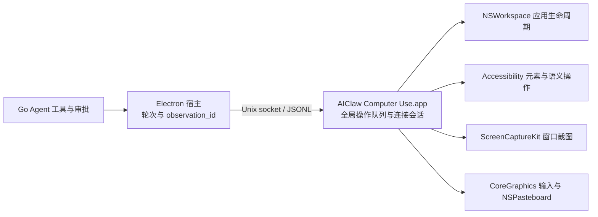

# AIClaw 原生桌面控制

AIClaw 在 **macOS 14.4 及以上**通过自有 Swift 应用 **AIClaw Computer Use.app** 执行桌面控制。Electron 宿主负责模型循环、审批与操作后的验证；独立原生进程负责应用发现、AX 元素、窗口截图和输入。Windows、Linux 不注册这些工具，也没有替代驱动。

实现源码在 `tools/computer-use/Sources/`。本轮依据 Codex 已发布产物恢复出的接口形状重建桌面能力，调查证据和未实现能力见 [Codex 能力与证据盘点](codex-computer-use-evidence.md)。没有复制或加载 Codex 的私有运行时。

## 进程、身份与 IPC

安装包携带 helper，首次使用先校验签名并复制到固定用户目录 `~/.aiclaw/computer-use/AIClaw Computer Use.app`；开发与正式安装均从这个位置运行。相同产物不重复复制；更新使用安装锁、同目录暂存与原子替换，校验失败保留旧 App。宿主通过 LaunchServices 启动该 helper，再直接连接其 Unix socket；不经过 CLI 代理或用户 MCP 配置。原生框架不加载到 Electron 内。

协议是 **`AIClawComputerUseIPC-1`**。请求使用 `{id, requestType, request}`，响应为 `{id, result}` 或 `{id, error}`。请求名称参考恢复出的 Codex 接口，**不与 `CodexComputerUseIPC-5` wire 兼容**。握手返回版本、工具清单和进程启动时捕获的自身可执行文件 SHA-256；宿主拒绝版本或可执行身份不匹配的驻留进程。

socket 名称包含规范化 bundle 路径和可执行文件 hash，因此不同可执行构建代际不会共享同一端点；开发与正式安装共享固定用户安装位置。socket 权限为 `0600`，父目录必须属于当前用户且不可由其他用户写入；服务验证连接 peer UID。JSONL 单帧上限为 16 MiB。此服务信任同 UID 的本机客户端；原生层不执行聊天审批，Go 审批只约束 AIClaw 工具入口。此边界不隔离当前用户的其他进程，也未还原 Codex 的发送者鉴权机制。

每个聊天轮次持有独立连接和 `ComputerSession`。宿主按序派发，原生服务另有覆盖完整异步请求生命周期的全局队列，避免不同连接在等待截图或输入时交错。断连立即标记连接失效，取消活动任务并丢弃尚未派发的请求；按键、鼠标按住操作有取消释放路径。轮次结束、归档、删除或关闭连接会清掉观测，不重放输入。驻留 helper 可继续运行，不安装 launch daemon。

## 权限与输入方式

辅助功能和屏幕录制权限属于 **AIClaw Computer Use.app**，与 Electron、AIClaw 主应用及其他 helper 分开。`computer_permissions` 只读当前状态；缺少所需权限的观察或动作返回错误，并显示独立权限说明窗口。窗口按钮在用户点击后向系统请求登记并打开对应设置，由 macOS 决定授权，不自动授予权限。

AX 查询和语义操作要求辅助功能权限；截图还要求屏幕录制权限。应用发现和生命周期操作不额外要求 AX。宿主审批仍遵循当前聊天策略，禁止把 AIClaw、其 helper 或审批窗口作为操作目标。

语义点击、设值、选择文本与辅助操作使用公开 AX API。坐标点击、拖动、滚动、按键、输入和粘贴使用项目自己的前台投递：先激活并重新验证目标应用/窗口，再发送 CoreGraphics 事件，可能切换前台、焦点或移动鼠标。**不承诺后台无干扰输入**，也未复刻 Codex 私有 SkyLight 投递路径。并发人工操作仍可能改变目标状态，操作回执不等于业务完成。

## 18 个工具

契约统一保存在 `tools/claw-agent/internal/agent/computer-tools.json`，构建时作为 `Tools.json` 放入 helper；握手投影原生参数，宿主独立校验字段。

| 能力 | 工具 | 行为 |
| --- | --- | --- |
| 权限与发现 | `computer_permissions`、`computer_list_apps`、`computer_find_apps`、`computer_frontmost_window` | 返回权限、应用候选和窗口 ID；发现合并有时限的 Spotlight 索引与 NSWorkspace 运行态，保留截断/索引未完成标记 |
| 应用生命周期 | `computer_start_app`、`computer_stop_app`、`computer_modify_app` | 精确 bundle ID 启动、正常退出、激活或隐藏；`deactivate` 明确实现为 hide，不强杀进程 |
| 观察与查询 | `computer_screenshot`、`computer_query` | 窗口截图/可选 AX 树，或按文字和角色查询控件；支持显式窗口 ID 消歧 |
| 九类动作 | `computer_click`、`computer_drag`、`computer_key`、`computer_type`、`computer_scroll`、`computer_set_value`、`computer_secondary_action`、`computer_select_text`、`computer_paste` | 覆盖恢复出的九种桌面 Action；点击修饰键、按住时长、按键时长、坐标滚动均有明确参数 |

`computer_screenshot` 默认只取截图，`include_ax=true` 才遍历完整 AX 树。ScreenCaptureKit 仅捕获选定窗口，PNG 长边限制为 1280 像素；坐标使用返回图像像素，服务据记录的图像尺寸和窗口几何换算。几何变化要求重新观察。

`computer_query` 是 AIClaw 的扩展，不是已经证明与 Codex 相同的搜索算法。它按文字/AX 角色进行有预算的定向遍历，返回匹配索引、窗口信息、访问数量与截断原因。空结果且搜索被截断时不能据此判定控件不存在。

`computer_select_text` 以原生字符串的 UTF-16 范围处理 Unicode，支持 prefix/suffix 消歧与选中/前后光标，并读回选择范围。`computer_paste` 支持 text、Markdown、HTML，由原生 NSPasteboard 准备并用前台 Command-V 投递；先物化保存原剪贴板，恢复时保留期间发生的新复制。异步粘贴与剪贴板消费效果仍需实际观察，不能把派发成功当成目标应用已消费。

## 观测与失败规则

宿主为观察分配 `observation_id`，动作必须携带本聊天、本轮次、本应用的最新 ID。查询只授权该次返回索引上的语义动作，不能用于任意键盘或坐标输入。像素动作要求截图，元素动作要求 AX 观测。应用生命周期操作会使相关观测失效。

原生索引只在所属连接中有效。动作前重新核对进程、窗口、角色、标题/描述/标识符、父窗口关系和当前几何；每个连接只保留当前目标窗口；切换应用、新观察、动作或断连清掉旧句柄。应用发现中的窗口 ID 只是选择依据，不授权未经观察的输入。

动作后宿主请求新的截图验证，并清掉旧索引。截图相同会提示没有可见进展；截图失败仍保留已派发回执，标记结果未知。原生错误、空结果、缺图、超时或断连不会伪造成成功；超时关闭连接，后续必须重新观察。启动进程不是完成用户任务，正常退出未确认时保留保存对话框等可能性，不强制终止。

## 构建、打包与签名

`node scripts/build-computer-runtime.mjs --universal` 在 macOS 上编译 arm64/x86_64，合并 universal 可执行文件，生成 bundle、工具资源和 hash 元数据，并校验签名。`make build-computer` 可构建本机版本。运行时随应用放在 ASAR 外，首次使用不下载驱动。

CI 的 macOS job 构建并验证 universal helper，上传 tar artifact；Linux 打包 job 接收该产物，为两个 macOS 架构交叉打包。Windows/Linux 包不附带原生桌面替代实现。

当前验证使用 **ad-hoc 开发签名**。构建脚本支持 `COMPUTER_USE_SIGN_IDENTITY`，但尚未配置生产证书或完成公证。不能据此保证更新后的权限持续有效；生产交付需要稳定签名身份与单独的安装、升级验收。

## 验证状态

2026-11-05 已完成：

- arm64/x86_64 universal 原生构建、签名完整性检查、真实 IPC 握手与 18 工具契约检查。
- 固定用户目录安装：相同构建不重复写入，更新候选验证失败保留旧 App，并发安装和链接目标拒绝测试通过。
- 352 项渲染/宿主测试、相关 Go 包测试、TypeScript 类型检查、Go 格式/vet/no-cgo 检查通过。
- 实际辅助功能与屏幕录制状态均为 true；应用发现、正常退出、重新启动与激活均以临时 AppKit fixture 验收。
- 九类原生动作实际生效：点击、拖动、按键、Unicode 输入、坐标滚动、设值、UTF-16 文本选择、辅助动作和粘贴。
- text、Markdown、HTML 粘贴在目标编辑器中验证；Markdown/HTML 加粗和中文编码正确，原剪贴板文本恢复。Markdown 标题、列表、表格、链接与转义另有原生转换测试。

[实际提交回执](/Users/zhouyy/.codex/visualizations/2026/11/05/01a1aacb-6689-7b11-841f-9bcc35cb2d46/rea-search/native-live-summary.json) 记录了 Unicode 值、富文本加粗、拖动/滚动事件及一次步进器辅助动作；[验证截图](/Users/zhouyy/.codex/visualizations/2026/11/05/01a1aacb-6689-7b11-841f-9bcc35cb2d46/rea-search/native-fixture-verified.png) 来自本实现选定窗口的 ScreenCaptureKit 截图。测试不操作已有用户应用或发送外部数据。

事件投递后的短暂窗口变化只重试只读观察，最多两次；输入本身不重放。开发构建采用时间戳依赖，未修改原生源、工具契约或版本时 `make dev` 不重复编译/签名。

上述结果验证本机 macOS arm64 上的测试 App，不证明任意第三方 App 或实际 x64 输入效果。仍使用开发签名，未完成生产证书、公证及升级授权保持验收。持续捕获、AX diff、app-specific instructions、历史、音频、日历、短信和锁屏能力见证据报告的差距清单。
