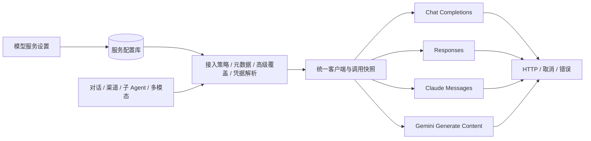

# 模型服务与推理协议

## 要解决的问题

厂商不等于协议。同一个 OpenAI 网关可以同时提供 Chat Completions 与 Responses；
Claude 和 Gemini 的原生接口则有不同的鉴权、消息、工具调用和流终止语义。
用一个 Chat Completions 请求结构覆盖所有服务，再从 400 文本中删除参数重试，
会掩盖配置错误，也无法可靠保存签名推理状态。

## 分层与边界

1. **模型服务配置**：保存接入服务类型、基础地址、密钥和模型清单。默认自动策略；服务级协议与模型级例外仅放在高级设置。已知官方域名可以识别接入服务，自建网关不会因模型名包含 GPT 而套用官方策略。
2. **接入策略与模型元数据**：OpenRouter 使用网关统一接口；OpenAI/Azure 直连使用有官方来源和核验日期的精确模型规则；Claude/Gemini 原生接入采用各自协议。未知网关和未知部署别名保留 Chat Completions，必要时使用高级覆盖。
3. **统一调用解析器**：优先级为模型覆盖 → 服务覆盖 → 接入策略/内置模型规则。OpenRouter 的明确能力元数据优先，缺失字段保持未知；能力缓存绑定接入服务及基础地址。模型清单不冒充能力探测。批量展示时配置只解析一次，避免逐模型反复解析整份清单。
4. **不可变调用快照**：每次采样、审批检查、压缩、媒体调用均解析当前服务配置。进行中的 HTTP 请求保留原快照；更新协议、地址或密钥从下一次请求生效，无需重新打开会话。模型变更后迟到的用量不归到新模型。
5. **协议适配器**：独立负责路径、鉴权、消息编码、工具 Schema、原生推理参数、流解析、错误封装与模型清单。Agent 只使用统一消息和工具结果，负责权限、执行、历史和重试。

图像/语音是独立操作能力，不因为协议支持对话就宣称支持所有媒体接口。
不支持的操作在发请求前失败。Claude Messages 不提供画图与语音操作；Gemini 原生媒体走 generateContent，模型自身仍需支持对应能力。
Gemini 媒体接口不接收 OpenAI 的像素尺寸参数；PCM 语音按服务返回的采样率封装为 WAV。

## 状态与恢复

可见消息继续使用统一结构。Chat reasoning_content、Responses 加密推理、Claude thinking/signature、
Gemini thoughtSignature 作为不透明的 `providerState` 随成功的 assistant 消息落库。
原生块按原顺序重放，不拼装、解释或在聊天 UI 展示推理签名。
状态绑定模型服务 ID、协议、端点、模型；更换任何一项后只沿用可见文本与工具历史。
半截输出只保留已显示文字，不提交半截工具调用或推理状态。

Responses 请求使用 `store:false`，会话恢复不依赖远端 response ID。
Claude 与 Gemini 使用完整本地历史重放。

## 可见采样记录与原生音频

助手消息的 `sampling` 保存界面已显示的推理摘要、采样 ID、模型、用量、TTFT 和耗时。协议适配器显式构建请求，不把这些本地显示字段或签名信息作为正文发送。旧存档不补造计时；失败或中断后的可见摘要同样保留，只有摘要的空助手消息不重放给模型。

音频默认依据当前模型路由的 `audioInput` 能力选择路径。OpenRouter 使用目录的 input_modalities；直接 OpenAI/Azure 的已知音频模型使用精确 ID；Gemini 使用模型目录的听写标记。未知能力继续使用配置的 STT 角色，不从一次错误猜测整个模型的能力。

原生音频当前覆盖 Chat Completions 与 Gemini 的 WAV/MP3 输入，单文件最多 8 MiB，每次请求保留最新的最多 180 秒音频。WAV 按数据长度和字节率计算时长；无法测量的压缩音频按整份 180 秒预算计算，因此不能叠加。其他格式或协议走 STT。超出预算、文件缺失或内容哈希改变会产生明确的省略说明；不会发送被替换的本地文件。存档只保存本地引用和拒绝记录，不重复存储音频字节。

只有 HTTP 400 的明确音频错误码且请求内仅有一段音频时，才记录该片段被当前端点/协议/模型拒绝。后续请求跳过该片段，当前失败不自动重放；泛化 400 和多音频的歧义错误不会污染拒绝记录。上下文音频估算是调度预算，不代表厂商计费 token。

## 迁移

新增服务默认自动路由；保留已有地址、密钥、模型及启用状态。旧版 Claude/Gemini 类型曾表示 OpenAI 兼容入口，迁移时以服务覆盖保留原协议，避免把自建兼容端点误转为原生协议。旧版已显式选择的原生协议也保留。OpenAI/Azure 等服务使用当前策略，内置规则只覆盖有依据的精确模型 ID；不从请求错误猜测协议。

模型服务列表展示有效协议及来源，上下文详情展示当前会话的调用协议。手动覆盖可清除，恢复到服务策略。OpenRouter 拉模型时缓存明确的 supported_parameters 和 input_modalities，不替换手写模型清单。已知不支持的工具、图片或推理设置在请求前报错；缺失能力信息继续由实际端点验证。

推理参数区分来源：应用默认档位是偏好，只在元数据明确支持该档位时发送；能力未知或不支持时使用模型默认，不改保存的偏好值。用户在会话中手动选择的档位标记为 `reasoningExplicit`，落库并严格校验，不能在错误后自动删除或降级。旧存档缺少来源标记时按默认偏好解释，原值保留。相同的显式档位在切换模型时继续保留。

发送历史前构建协议可重放视图：含非法 JSON 参数的历史 assistant 调用批次及其关联结果，整体转换为带原始参数和结果的文字记录，不作为新工具调用重放。有效批次与原生签名保持不变；原始会话、文件产物和界面记录不修改。继续对话与压缩共用这一转换边界。

模型目录使用一次读取的服务快照构建请求、解析元数据和标注缓存来源。每次配置写入原子递增 revision，目录缓存以原 revision 条件写入。拉取中发生地址、协议、密钥变更或服务删除时拒绝缓存写回和旧目录合并，提示重新拉取；缓存刷新本身不递增配置 revision。

## 验收

- 四种协议分别验证文本流、工具调用/结果关联、并行工具、图片输入、用量和错误。
- 中断、截断、限额及失败响应都不产生可执行的半截调用。
- 原生签名落库后可恢复；换端点/模型/协议不重放旧签名。
- 老数据库迁移保留原值；未知协议拒绝写入；密钥不在列表和事件中回显。
- 模型清单、网络诊断和所有调用入口采用选定协议。
- 桌面协议选项经过真实 Vue/preload 测试；完整 `make check` 验证。

## 参考

- [OpenAI Responses 迁移](https://developers.openai.com/api/docs/guides/migrate-to-responses)
- [OpenAI reasoning 状态](https://developers.openai.com/api/docs/guides/reasoning)
- [Claude Messages](https://platform.claude.com/docs/en/api/messages)
- [Claude streaming](https://platform.claude.com/docs/en/build-with-claude/streaming)
- [Gemini function calling](https://ai.google.dev/gemini-api/docs/generate-content/function-calling)
- [Gemini thought signatures](https://ai.google.dev/gemini-api/docs/generate-content/thought-signatures)

- [OpenRouter 统一接口约定](https://openrouter.ai/docs/api_reference/overview)
- [OpenRouter 模型能力字段](https://openrouter.ai/docs/api/api-reference/models/list-all-models-and-their-properties)
- [Azure 推理模型与接口限制](https://learn.microsoft.com/azure/foundry/openai/how-to/reasoning)
